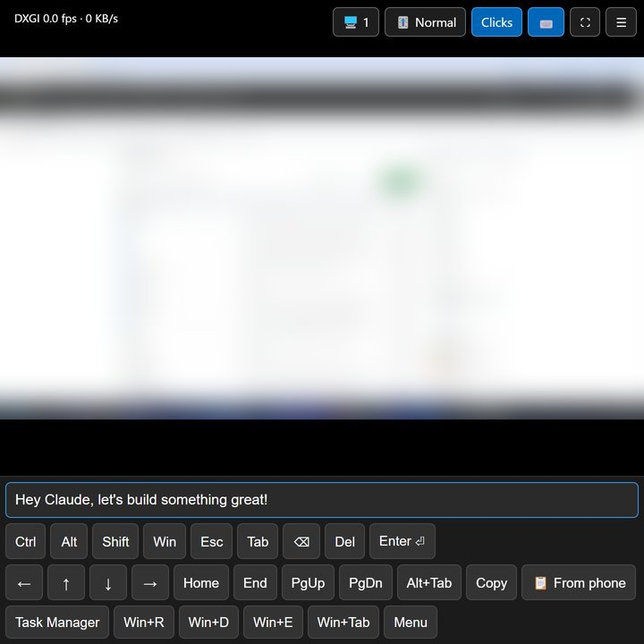
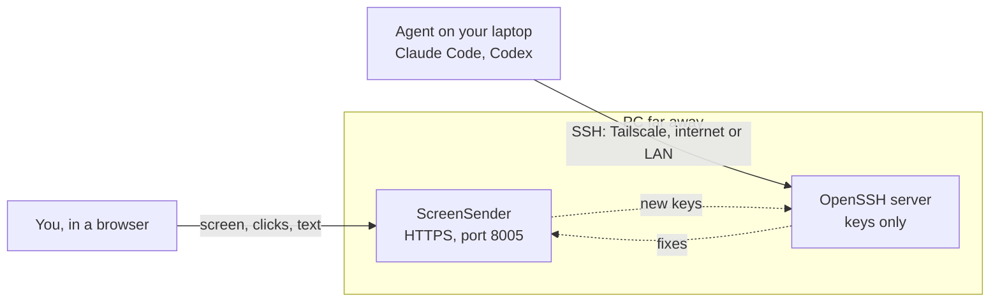

# ScreenSender

**English** | [Русский](README.ru.md)

Control a Windows PC from a browser. ScreenSender shows the desktop on a web page, and you click,
scroll and type on it. With the SSH setup in [`ssh/`](ssh/README.md), an AI agent on your laptop
(Claude Code, Codex) can work on the same PC as well.

<p align="center"></p>

You don't need ScreenSender for normal remote access to your own computer: use Chrome Remote Desktop,
or RDP over Tailscale. ScreenSender is for machines where nobody is around, such as test machines:
the agent installs and fixes things over SSH, and you look at the screen in a browser. I first made
it to use my own PC while I was on a trip.

It is a single Python file and a web page, built for slow links: only the parts of the screen that
changed are sent, so a still screen costs no traffic at all.

## Screen and command line together

The screen is for you, the command line is for the agent. Together they do more than each one alone.



- **Only SSH:** you can't see the screen. Commands run in a separate session; you can't see or click
  the windows on the desktop.
- **Only the screen:** the agent on your laptop can't work on the PC. You would have to install it
  on the PC and log in there.
- **Both:** you see the desktop, and the agent runs commands on the same PC. If one way in breaks,
  fix it with the other: the agent restarts a hung ScreenSender over SSH, and a new SSH key can be
  pasted through the screen.

The agent can also see the screen itself: see [Scripts and AI agents](#scripts-and-ai-agents).

## Set it up with Claude

The easiest way is to ask Claude. Open Claude Code on the PC you want to reach, and write:

> Install ScreenSender from https://github.com/parhipov/ScreenSender on this PC, so I can use it
> while I'm away. Follow its CLAUDE.md.

Then, on your laptop:

> Set up SSH access from this laptop to my PC. Follow ssh/CLAUDE.md from
> https://github.com/parhipov/ScreenSender.

Claude does the install and the checklist before you leave. It asks you only for what a person must
do: type a password, set up the router. That's all: after this you don't need Claude on the PC.
To do it by hand, see [Quick start](#quick-start).

## Compared with other tools

| | Client | Other company's servers | Your agent works on the PC | Lock screen | Open ports |
|---|---|---|---|---|---|
| ScreenSender + SSH | browser | no | yes, over SSH | can't see | HTTPS, SSH |
| Same, over Tailscale | browser + Tailscale app | Tailscale | yes, over SSH | can't see | none |
| Chrome Remote Desktop | browser | Google | no | can see | none |
| TeamViewer, AnyDesk | app | yes | no | can see | none |
| RDP | app | no | no | can sign in | 3389 or VPN |

- **The main minus is open ports.** SSH gives admin access to the PC, and its key on the laptop has
  no password, so the agent can use it: whoever steals the laptop gets the PC. ScreenSender's port is
  open too, and only a password protects it. See [Security](#security) and
  [ssh/README.md](ssh/README.md#security).
- **Tailscale removes the open ports**, but every client needs the Tailscale app and an account,
  some networks block it, and the PC's key expires after about six months unless you turn key
  expiry off. The project supports both routes, and they don't depend on each other.
- **If the PC locks,** ScreenSender can't see the lock screen, Chrome Remote Desktop can. But the
  agent can restart the PC over SSH (`shutdown /r /t 0`); with automatic sign-in the screen is back
  in a couple of minutes.

## Features

- **Low traffic.** The picture is split into tiles and only changed tiles are sent. When you zoom in,
  only the visible part is sent. Typing in a document costs a few KB.
- **Fast capture.** DXGI Desktop Duplication grabs a 4K frame in about 5 ms and reports when nothing
  has changed. GDI is the fallback.
- **Touch control.** Tap, double tap, hold for a right click, hold and drag to select text or move
  windows, pinch to zoom, two-finger scroll.
- **Keyboard panel.** Text typed in the panel goes straight to the PC in any language, whatever
  keyboard layout the PC has. Sticky Ctrl/Alt/Shift/Win, arrows, Esc, Tab, Alt+Tab, Task Manager
  and more.
- **Paste from the phone.** Long texts and code arrive instantly through the PC clipboard,
  without editors' auto-indent.
- **Multiple monitors.** Switch between monitors, or show all of them together.
- **Quality presets** for slow and fast links. Once the screen is still, the picture is sent again
  in high quality, so text is crisp after scrolling.
- **Login page** and optional **HTTPS** with a self-signed certificate made on first start.

## Requirements

- Windows 10 or 11 on the PC. Mouse and keyboard input use the Windows API; on other systems
  the page is view-only.
- Python 3.10 or newer.
- Any modern browser, on a computer or a phone: Chrome, Edge, Safari, Firefox.

## Quick start

```
git clone https://github.com/parhipov/ScreenSender.git
cd ScreenSender
pip install -r requirements.txt
copy config.example.json config.json
```

Open `config.json` and set `username` and `password`, then start the server:

```
python server.py
```

If `config.json` is missing, it is created with default values on first start.
The startup output shows the addresses to open:

```
Capturing monitor 1: 2560x1440 at (0,0), capture=auto
  LAN:      http://192.168.1.20:8005/
  Internet: public_ip is not set in config.json
  Login:    alice / correct-horse-battery-staple
Press Ctrl+C to stop
```

Open the LAN address on another device in the same network and log in with the username and
password from `config.json`. The browser stays logged in for 30 days.
On first start, Windows Firewall asks whether Python may accept connections; allow it,
or other devices will not reach the PC.

### Access from the internet

1. On the router, forward a TCP port (8005 by default) to the PC.
2. Set `"https": true` and a strong password in `config.json`.
   See [Security](#security) before you do this.
3. Optionally set `public_ip` to your external IP. It is only used to print the internet address
   and to put it into the certificate.

With [Tailscale](https://tailscale.com) on the PC and on the device you connect from, no port
forwarding is needed: the startup output then shows the PC's Tailscale address as well.

## Using it

| On the phone | On the PC |
|---|---|
| Tap | Left click |
| Double tap | Double click |
| Hold, then let go | Right click |
| Hold, then drag | Drag with the left button: select text, move windows, drag files |
| Pinch | Zoom the picture in; only the visible part is then sent |
| Drag with one finger (zoomed in) | Look around |
| Drag with two fingers, up/down or sideways | Mouse wheel |

In a desktop browser, the mouse works as usual, dragging included.

### Toolbar

The toolbar is in the top right corner. The interface is in English, or in Russian when the browser
prefers Russian.

| Button | What it does |
|---|---|
| **🖥 1** | Switches the monitor: 1, 2, …, then all together. Shown only with several monitors. |
| **🎚 Low / Normal / Sharp** | Picture quality. The browser remembers it. |
| **Clicks** | Turns mouse input on and off, handy while you look around a zoomed picture. |
| **⌨** | Opens the keyboard panel. |
| **⛶** | Fullscreen. |
| **☰** | Hides the other buttons and the status line. |

The top left corner shows the capture method (DXGI or GDI), updates per second and KB/s.

### Keyboard

The **⌨** panel has a text field and two rows of keys.

- Whatever you type in the field is typed on the PC right away. Autocorrect and word suggestions
  work too: the page sends only the difference.
- **Ctrl, Alt, Shift, Win are sticky.** Tap Ctrl, then a letter, to get Ctrl+letter.
  This also works with a Russian keyboard layout on the phone: Ctrl+С is sent as Ctrl+C.
  Tap an active modifier again to send it alone; Win alone opens the Start menu.
  Sticky modifiers also apply to the next tap on the picture: Shift+tap extends a selection,
  Ctrl+tap adds to it.
- The other keys: Esc, Tab, Backspace, Del, Enter, arrows, Home, End, PgUp, PgDn, Alt+Tab,
  F5, Copy (Ctrl+C), Undo (Ctrl+Z) and Ctrl+V, which pastes the PC clipboard.
- The third row: Task Manager, Win+R (Run), Win+D (desktop), Win+E (Explorer), Win+Tab and
  the Menu key.
- With the field focused in a desktop browser, a physical keyboard works as well,
  including shortcuts.

### Paste from the phone

Long-press the text field and choose **Paste**, or tap **📋 From phone** to read the phone clipboard
directly (this needs HTTPS). The text is put into the PC clipboard and pasted with Ctrl+V,
so long texts and code arrive instantly and editors do not auto-indent every line.
Ctrl+V in a desktop browser does the same. Note that this replaces what was in the PC clipboard.

## Configuration

Settings live in `config.json` next to `server.py`. Restart the server after changing them.

| Key | Default | Meaning |
|---|---|---|
| `host` | `"0.0.0.0"` | Listen address. `0.0.0.0` means all network interfaces. |
| `port` | `8005` | Listen port. |
| `https` | `false` | Serve HTTPS with a self-signed certificate (see [HTTPS](#https)). |
| `public_ip` | `""` | Your external IP or host name. Only printed at startup and put into the certificate. |
| `username`, `password` | `"admin"`, `"change-me"` | Login for the web page. Changing them logs everyone out. |
| `monitor` | `1` | Monitor shown at start: `1`, `2`, …, or `0` for all together. It can be switched from the page. |
| `capture` | `"auto"` | `auto` or `dxgi`: DXGI Desktop Duplication, falling back to GDI when it is unavailable. `gdi`: GDI only. |
| `fps` | `10` | Capture rate. The phone gets updates no faster than this. |
| `max_width` | `1600` | The picture is scaled down to this width. Lower it for a slow uplink (e.g. `1280`); `0` keeps the full resolution. |
| `tile_size` | `64` | Tile size in pixels (16 at least). Only changed tiles are sent. |
| `draw_cursor` | `true` | Show the PC mouse pointer on the page. |
| `allow_input` | `true` | Allow clicks, scrolling and typing. `false` makes the page view-only. |

## HTTPS

With `"https": true` the server makes `cert.pem` and `key.pem` on first start and serves HTTPS only.
The certificate is valid for 800 days and is made again when it expires. It covers the LAN IP,
`public_ip`, `127.0.0.1` and `localhost`. If the PC gets a different LAN IP, delete `cert.pem`
and restart to make a new certificate.

The phone browser warns about the unknown certificate once; choose "proceed" and it is remembered.
To get rid of the warning, install the certificate on the phone as a trusted root.
Open `https://<pc>:8005/cert`, then:

- **Android:** Settings → Security → Encryption & credentials → Install a certificate → CA certificate.
  The exact path differs between vendors.
- **iPhone:** install the downloaded profile in Settings → General → VPN & Device Management,
  then turn on full trust in Settings → General → About → Certificate Trust Settings.

HTTPS is also needed for the **📋 From phone** button, because browsers let pages read
the clipboard only over HTTPS.

## Security

Whoever logs in fully controls your PC. Before you open the port to the internet:

- **Use a long random password.** The server waits a second after a wrong password,
  but this does not stop guesses made in parallel.
- **Use HTTPS.** Over plain HTTP the password, the screen and everything you type travel
  unencrypted. Instead of the built-in HTTPS you can put a reverse proxy with a real certificate
  (for example, [Caddy](https://caddyserver.com/)) in front of the server.
- **Keep `key.pem` private.** The certificate is a CA certificate, so whoever has `key.pem` can make
  certificates for any website, and a phone that trusts this certificate will accept them.
  `key.pem` and `cert.pem` are in `.gitignore`. Remove the certificate from the phone once you stop
  using ScreenSender.
- A login lasts 30 days from the last visit. Changing the password, or deleting `secret.key`
  and restarting the server, logs out every device.
- Set `"allow_input": false` if you only need to watch the screen.

## Running unattended

If ScreenSender is your only way into a PC far away, the `deploy/` folder sets it up to survive
on its own: a supervisor that restarts the server whenever it exits or stops responding, scheduled
tasks that start it at sign-in, and an update script that you start when you want an update: it
pulls from git, checks that the new version works and rolls back if it does not. Nothing updates
by itself. The server then runs as administrator, so it can
control elevated windows; `install.ps1 -AdminShell` also adds an elevated shell that opens without
a UAC prompt, which is otherwise impossible to answer remotely. [CLAUDE.md](CLAUDE.md) walks through the install, a checklist for leaving
the PC alone (automatic sign-in, no sleep, no lock, power cuts) and updates. It is written for
Claude Code, but people can follow it too.

The [`ssh/`](ssh/README.md) folder adds a way in that does not depend on ScreenSender: an SSH server
on the PC, so Claude Code on another computer can run commands there, copy files and repair
ScreenSender if it stops.

## Scripts and AI agents

A script or an AI agent on another computer can use the server the way the page does: log in once,
then take screenshots and send input. With HTTPS add `-k` to curl, unless the certificate is trusted.

```
curl -c jar -d "username=alice&password=..." http://192.168.1.20:8005/login
curl -b jar -o screen.jpg http://192.168.1.20:8005/screenshot
curl -b jar -H "Content-Type: application/json" -d '{"x": 0.5, "y": 0.25}' http://192.168.1.20:8005/click
```

| Request | What it does |
|---|---|
| `GET /screenshot` | The shown monitor as a JPEG, scaled to `max_width`, taken after the request arrived. The pointer is not drawn; the `X-Cursor` header gives its position. |
| `POST /click` | `{"x", "y", "button": "right", "mods": ["ctrl"]}`; `button` and `mods` are optional. |
| `POST /mouse` | `{"actions": [{"drag": "down", "x", "y"}, {"drag": "move", …}, {"drag": "up", …}]}`: a drag with the left button. |
| `POST /scroll` | `{"x", "y", "dy", "dx"}`: wheel notches; positive `dy` scrolls up. |
| `POST /key` | `{"actions": [{"text": "…"}, {"paste": "…"}, {"key": "enter", "mods": ["ctrl"], "repeat": 1}]}` |

Being logged in costs no traffic: data flows only while a request runs, and the screen is not even
captured between requests. Each screenshot is a whole picture, though: about 200 KB for a busy
1600×900 screen, where the page would get only the changed tiles.

Coordinates are 0..1 of the picture: a point (x, y) of the screenshot is sent as x / width, y / height.
Whoever has the password controls the PC, the agent included; `"allow_input": false` leaves it only
the screenshots.

## Notes and limitations

- DXGI capture cannot see the lock screen or UAC prompts. When it fails, GDI is used for
  the next 30 seconds and DXGI is then tried again.
- The lock screen and UAC prompts on the secure desktop can be neither seen nor controlled through
  ScreenSender. If it is your only way in, make sure the PC never locks; see Running unattended.
  If it locks anyway, a restart over SSH brings the screen back, once automatic sign-in is set up.
- Windows of programs running as administrator accept input only when the server runs as
  administrator too.
- All viewers share one picture: switching the monitor switches it for everyone.
- Text is typed as Unicode characters. Some programs that read raw key codes, such as games,
  may ignore it.
- There is no sound, no file transfer and no copying text from the PC back to the browser.
  Over SSH, files go with `scp`.

## How it works

- **Capture.** One thread grabs the screen at `fps`, scales it to `max_width` and compares it with
  the previous frame tile by tile. Each tile remembers the frame in which it last changed. Nobody
  watching means no capturing; the capture device is released after 30 idle seconds.
- **Per-viewer state.** Every browser tab is a viewer. The server remembers which version of each
  tile the viewer has drawn, so each request returns only the tiles it lacks, and only inside
  the area the page shows (plus a one-tile margin).
- **Long polling.** `GET /frame` waits until there is something new for this viewer, for up to
  5 seconds. The page asks for the next update only after it has drawn the previous one,
  so a slow link lowers the frame rate instead of building up lag.
- **Encoding.** Small changed areas go as WebP. When more than half of the visible area needs
  updating, it goes as one picture: a JPEG while the screen is moving, which encodes much faster,
  and sharp otherwise. After 0.7 s without changes, tiles that were sent in low quality are sent
  again in high quality.
- **Update format.** A 4-byte big-endian header length, a JSON header (picture size, cursor position,
  rectangle positions and sizes), then the image pieces back to back.
- **Input.** Text is sent as Unicode `SendInput` events, keys as virtual-key events, clicks
  and the wheel through `mouse_event`, pasted text through the Win32 clipboard.

### Files

| File | What it is |
|---|---|
| `server.py` | The whole server: capture, tiles, web endpoints, input, HTTPS. |
| `static/index.html` | The viewer page: drawing, zoom, gestures, keyboard panel. |
| `static/login.html` | The login page. |
| `config.example.json` | Example settings to copy to `config.json`. |
| `deploy/` | Supervisor, update with rollback and the install script for unattended use. |
| `CLAUDE.md` | How to install, leave and update an unattended PC, written for Claude Code. |
| `ssh/` | SSH access to the PC for Claude Code, separate from ScreenSender. |
| `docs/` | Pictures for this README. |

## License

[MIT](LICENSE)
